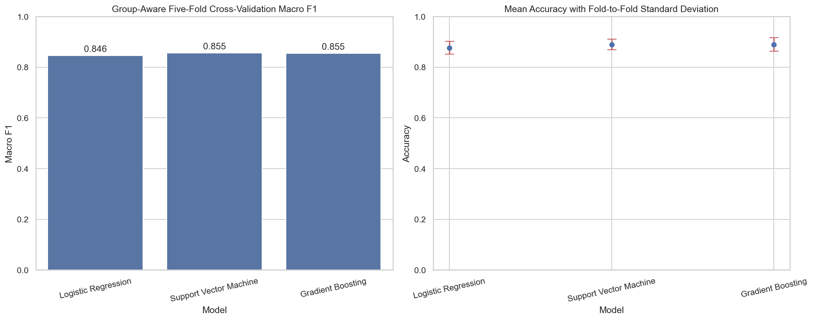

# Sleep Disorder Classification

A reproducible machine-learning project that classifies a record as
**Healthy**, **Insomnia**, or **Sleep Apnea** from sleep, lifestyle, and
physiological features.

The deployable artifact is one scikit-learn pipeline containing feature
engineering, missing-value handling, encoding, scaling, and classification.
Training and prediction therefore apply exactly the same transformations.

## Results

First, one stratified, group-disjoint fold is reserved as a holdout. Models are
then compared with stratified, group-aware five-fold cross-validation on the
remaining training rows.
Rows with identical engineered model features stay in the same fold, preventing
equivalent patient profiles from appearing in both training and validation.
Grouping ignores unused columns and treats normalized BMI labels and blood
pressure formatting consistently.
Selection was based on mean macro F1, which gives equal importance to all
three classes.

| Model | Macro F1 | Mean accuracy | Fold accuracy SD |
| --- | ---: | ---: | ---: |
| Logistic Regression | 0.848 | 0.886 | 0.039 |
| **Support Vector Machine** | **0.874** | **0.903** | **0.014** |
| Gradient Boosting | 0.851 | 0.886 | 0.025 |

Support Vector Machine achieved the highest unrounded mean macro F1 and was
fitted on the 299 training rows for the saved pipeline. On the 75 reserved
holdout rows, it achieved **0.883 macro F1** and **0.920 accuracy**. The holdout
was not used to choose the model. Full per-class scores and a confusion matrix
are in [`reports/holdout_evaluation.json`](reports/holdout_evaluation.json).
These are internal dataset estimates, not results from an external test set.



## What Was Corrected

- The model now saves preprocessing and classification as one pipeline.
- Training and prediction use identical feature transformations.
- `Person ID` is excluded because it is an identifier, not a clinical feature.
- Blood pressure is parsed into systolic and diastolic values, and severe
  hypertension is checked before the broader stage-2 condition.
- Categorical features use an encoder that safely handles unseen values.
- Surrounding whitespace is trimmed from gender, occupation, and BMI labels
  before encoding, consistently across training and prediction.
- Numeric and categorical missing values are imputed inside each validation
  fold, preventing preprocessing leakage.
- Equivalent engineered feature rows are assigned to the same validation group
  to prevent duplicate-profile leakage, even when raw formatting or unused
  columns differ.
- Model selection uses stratified, group-aware five-fold cross-validation
  within a training partition; a group-disjoint holdout evaluates the winner.

## Repository Structure

```text
sleep-disorder-classification/
├── data/
│   └── README.md
├── examples/
│   ├── patient.json
│   └── patients.csv
├── models/
│   └── sleep_disorder_pipeline.joblib
├── reports/
│   ├── model_comparison.png
│   └── holdout_evaluation.json
├── src/
│   ├── train.py
│   ├── predict.py
│   ├── evaluate.py
│   ├── evaluation.py
│   ├── model_info.py
│   ├── output.py
│   ├── web.py
│   ├── web_ui.html
│   ├── web_patient_form.html
│   ├── web_compare.html
│   ├── web_model.html
│   ├── web_report.html
│   ├── web_batch_results.html
│   ├── web_evaluate.html
│   ├── web_evaluation_results.html
│   ├── web_evaluation_rows.html
│   └── preprocessing.py
├── tests/
│   ├── test_prediction.py
│   ├── test_evaluation.py
│   ├── test_model_info.py
│   ├── test_output.py
│   ├── test_web.py
│   ├── test_preprocessing.py
│   └── test_training.py
├── .github/workflows/ci.yml
├── .dockerignore
├── .gitignore
├── Dockerfile
├── LICENSE
├── README.md
└── requirements.txt
```

## Dataset

The project uses the
[Sleep Health and Lifestyle Dataset](https://www.kaggle.com/datasets/uom190346a/sleep-health-and-lifestyle-dataset).
The local training file contains 374 records and 13 columns. Missing target
values are interpreted as `Healthy`.

The dataset is published separately under **CC0: Public Domain**. It is not
covered by this repository's MIT License. Download instructions are available
in [`data/README.md`](data/README.md); the dataset CSV is intentionally excluded
from Git.

## Installation

Python 3.11 or newer is recommended.

```bash
git clone https://github.com/Dochikhoa2006/Sleeping-Disorder-Multi-Classification.git
cd Sleeping-Disorder-Multi-Classification
python -m venv .venv
source .venv/bin/activate
python -m pip install --upgrade pip
python -m pip install -r requirements.txt
```

On Windows PowerShell, activate the environment with:

```powershell
.venv\Scripts\Activate.ps1
```

## Train

Place the dataset at
`data/Sleep_health_and_lifestyle_dataset.csv`, then run:

```bash
python -m src.train
```

This command compares the three candidate models, then regenerates:

- `models/sleep_disorder_pipeline.joblib`
- `reports/model_comparison.png`
- `reports/holdout_evaluation.json`

Optional paths can be supplied with `--data`, `--model-output`,
`--report-output`, and `--evaluation-output`.
All four paths must differ, including when symlinks resolve to the same file.
Path collisions are rejected before loading data or updating any artifacts.

Training requires at least one row and a `Sleep Disorder` column. Non-missing
labels must be exactly `Healthy`, `Insomnia`, or `Sleep Apnea`; unsupported
labels (including typos) are rejected before model selection or artifact
writes. Missing labels continue to be interpreted as `Healthy`.

Model comparison stops if a cross-validation fold fails or returns a
non-finite score, so incomplete validation results cannot select the saved
model. Existing artifacts are not updated in that case.
Every fold's macro F1 uses the full training class list; classes absent from
a validation fold contribute zero rather than disappearing from the average.

## Inspect the saved model

View the selected model, class labels, training metadata, cross-validation
results, and SHA-256 fingerprint without supplying patient data:

```bash
python -m src.model_info
python -m src.model_info --model models/sleep_disorder_pipeline.joblib
python -m src.model_info --include-features
```

`--include-features` adds a `transformed_features` array containing the numeric
and encoded categorical column names in classifier input order. This option
requires a pipeline with preprocessing steps.

The command prints JSON to standard output, which can be redirected to a file.
Training metadata and validation results are `null` for classifiers that do
not store them. Only inspect trusted Joblib files, as loading them can execute
code.

For programmatic inspection, retrieve the transformed feature names from the
saved pipeline's preprocessing steps:

```python
import joblib

pipeline = joblib.load("models/sleep_disorder_pipeline.joblib")
feature_names = pipeline[:-1].get_feature_names_out()
```

## Evaluate on labeled data

To assess the saved model on another labeled CSV, include all input feature
columns and a `Sleep Disorder` column with explicit `Healthy`, `Insomnia`, or
`Sleep Apnea` labels:

```bash
python -m src.evaluate --data external_patients.csv --output external_evaluation.json
```

Omit `--output` to print the complete JSON report to standard output without
creating a report file, for example when piping the result to another tool:

```bash
python -m src.evaluate --data external_patients.csv
```

File reports replace their destination only after writing succeeds. A failed
write preserves any existing report and removes the temporary file.

Gzip-compressed CSVs are also accepted with `--data external_patients.csv.gz`.
The dataset fingerprint identifies the original compressed file contents.

The JSON report contains accuracy, macro F1, per-class precision and recall,
and a confusion matrix. The `dataset_sha256` and `model_sha256` fields identify
the exact CSV and model file contents used, so reports can be traced to their
inputs even when filenames are reused. It also counts rows whose engineered
features match a profile used to fit the model. Those rows are excluded from
the metrics; the command fails if no unseen profiles remain. Training
fingerprints are stored in the model artifact. As with the training report,
these metrics are only as representative as the supplied dataset.

The `class_row_counts` section breaks down total, training-overlap, and
evaluated rows for every model class, including classes with zero rows. This
shows whether excluding training profiles leaves a class underrepresented.

The report also includes `unique_evaluated_profiles` and
`duplicate_evaluated_rows`, based on engineered model features. Equivalent
profiles with different IDs or formatting count as repeats. Metrics still
include every evaluated row; these counts make repeated profiles visible.

## Predict

### Local browser interface

Start a form-based interface with no additional dependencies:

```bash
python -m src.web
```

Open **http://127.0.0.1:8765** in a browser. Edit the prefilled example and
select **Predict sleep class** to see the saved model's prediction. Invalid
entries show an explanation and retain your values for correction. The server
binds only to this computer; entries are not stored or sent to external
services. Stop it with Ctrl+C. Optional `--port` and `--model` arguments select
a different port or trusted model file.

Use **Open printable report** to open the current form values and a fresh
prediction in a separate tab. The report includes all submitted features and
a UTC generation time. Use the browser's Print command to print it or save it
as PDF. The report is generated in memory; the server does not keep a copy.

**Save profile** downloads the current valid form values as
`patient-profile.json`, compatible with CLI JSON prediction. **Load a saved
profile** restores a single JSON object to the form for review and editing.
Saving and loading profiles do not run predictions or require loading a model.
The server processes uploads in memory and keeps no profile library.

Select **Compare profiles** (or open **http://127.0.0.1:8765/compare**) to edit
two profiles side by side. The results show each predicted class and a table
of the fields entered differently. Both profiles must pass validation before
either prediction runs. Comparisons describe model outputs, not causal
effects of lifestyle changes.

The **Model dashboard** at **http://127.0.0.1:8765/model** shows the current
model's class labels, training and holdout row counts, stored cross-validation
scores, dependency versions, and file fingerprint. The selected classifier is
marked in the score table. Use **Download model details** to export the same
information as JSON. Models without stored metadata show **Not recorded**.

Use **Evaluate labeled data** at **http://127.0.0.1:8765/evaluate** to upload
a UTF-8 CSV with patient features and explicit `Sleep Disorder` labels. The
page shows accuracy, macro F1, per-class scores, excluded training overlaps,
and a confusion matrix with actual labels on rows and predictions on columns.
Download the complete JSON report, including dataset and model fingerprints.
The upload is processed in memory using the same evaluation rules as the CLI;
files containing only training profiles are rejected.

The evaluation page also previews individual outcomes and downloads CSVs for
all records or just misclassified records. Each row contains its parsed data
record number, actual class, predicted class, and outcome. Training overlaps
have no prediction and are marked excluded. Record numbers exclude the header
and blank lines; the preview shows 100 records, while downloads include all.

For batch prediction, use **Predict a whole CSV** to choose a UTF-8 patient
CSV and download `sleep-predictions.csv`. The output preserves input columns
and row order and adds `Predicted Sleep Disorder`. An example CSV is available
from the interface. Uploads, including form overhead, are limited to 2 MiB and
processed in memory. Every row is validated before prediction; an invalid file
shows an error instead of downloading partial results.

**Preview results** shows class counts for the whole batch and the first 100
rows in input order. Download the complete CSV from that page, including rows
beyond the preview. **Download CSV directly** skips the preview. Results stay
in the browser response; the server does not keep a batch history.

Search across patient columns or filter by predicted class from the preview.
Filters cover the whole batch, including rows beyond the first 100, and do
not rerun predictions. Download matching rows separately or clear the filters
to return to the original results. The top download always keeps the full batch.
Sort the current results by any column in ascending or descending order.
Numeric patient fields sort numerically, and the matching-row download uses
the same order as the preview. Original CSV row numbers remain visible;
**Clear** restores input order. The top full-batch download is unchanged.

### Command-line prediction

Try the included synthetic patient examples with the saved model:

```bash
python -m src.predict --input-json examples/patient.json
python -m src.predict --input-csv examples/patients.csv --output-csv predictions.csv
```

The CSV example includes a `Record ID` column that is preserved in the exported
predictions. These examples also work with `--validate-only` (omit the output
option) to check their format without loading a model.

Run the interactive predictor:

```bash
python -m src.predict
```

For a repeatable non-interactive prediction, create `patient.json`:

```json
{
  "Gender": "Male",
  "Age": 31,
  "Occupation": "Software Engineer",
  "Sleep Duration": 7.2,
  "Quality of Sleep": 8,
  "Physical Activity Level": 60,
  "Stress Level": 4,
  "BMI Category": "Normal",
  "Blood Pressure": "120/80",
  "Heart Rate": 70,
  "Daily Steps": 8000
}
```

Then run:

```bash
python -m src.predict --input-json patient.json
```

For several patients, supply a JSON array of objects with the same fields.
JSON files may use UTF-8 with or without a byte-order mark.
Predictions are returned in input order, and invalid records are identified by
their position. Duplicate JSON field names are rejected, including when their
values match, so repeated fields cannot silently overwrite patient data.
To save machine-readable results:

```bash
python -m src.predict --input-json patients.json --output-json predictions.json
```

The output file contains an array of predicted class names in the same order
as the input. A single patient object also works with `--output-json` and
produces a one-element array.

### CSV batch prediction

For spreadsheet exports, save a CSV with the same feature names as column
headers and one patient per row. Extra columns, such as a local record ID, are
preserved in the output:

```bash
python -m src.predict --input-csv patients.csv --output-csv predictions.csv
```

The output adds a `Predicted Sleep Disorder` column. Numeric fields must contain
numbers; blood pressure uses `systolic/diastolic` format. The command reports
the CSV row number for invalid records and does not write an output file until
all rows have passed validation. The input and output paths must differ.
Malformed CSV quoting is rejected before prediction or output writing.

JSON and CSV prediction exports are written to a temporary file beside the
destination, then replace it after a successful write. If writing fails, any
existing export is preserved and the temporary file is removed.

### Validate inputs without predicting

Check JSON or CSV patient records before running inference:

```bash
python -m src.predict --input-json patients.json --validate-only
python -m src.predict --input-csv patients.csv --validate-only
```

This mode applies the same input validation as prediction and prints the number
of valid records. It requires no model file, stops on invalid records, and
cannot be combined with `--output-json` or `--output-csv`.

Only load `.joblib` files from sources you trust. Joblib artifacts can execute
code when loaded.

### Local JSON API

Start `python -m src.web`, then call the prediction API from another terminal:

```bash
curl http://127.0.0.1:8765/api/health
curl -H "Content-Type: application/json" \
  --data-binary @examples/patient.json \
  http://127.0.0.1:8765/api/predict
```

`POST /api/predict` accepts one patient object or a non-empty JSON array, using
the same fields and validation as the CLI. Successful responses always contain
a prediction array in input order:

```json
{"predictions": ["Healthy"], "count": 1}
```

Requests are limited to 2 MiB. Invalid batches return `400` with an `error`
message identifying the invalid patient; no partial predictions are returned.
Unsupported content types return `415`, oversized requests `413`, and model
file access failures `503`. Unknown API routes return `404` and incorrect
GET/POST methods `405`. API errors use JSON. The API stays on localhost and
does not store or log patient inputs. `GET /api/health` is a lightweight
liveness check that does not load the model. Predictions remain educational
model outputs, not diagnoses.

## Tests

```bash
python -m unittest discover -s tests -v
```

GitHub Actions runs the same test command with Python 3.11, 3.12, and 3.13 for
every push and pull request. Each version runs independently, so a failure on
one version does not cancel the other checks.
Each version also runs the included JSON and CSV prediction examples and
exports the saved model's feature schema to check the documented workflows.

## Docker

Build the inference image:

```bash
docker build -t sleep-disorder-classifier .
```

Run it interactively:

```bash
docker run --rm -it sleep-disorder-classifier
```

Or provide a JSON file:

```bash
docker run --rm \
  -v "$PWD/patient.json:/tmp/patient.json:ro" \
  sleep-disorder-classifier \
  --input-json /tmp/patient.json
```

## Tech Stack

- Python
- pandas and NumPy
- scikit-learn
- SciPy
- Matplotlib and seaborn
- joblib

Exact tested dependency versions are pinned in `requirements.txt`.

## Limitations

- The dataset is small and synthetic, so reported scores may not generalize to
  real clinical populations.
- The model has not been clinically validated.
- Predictions depend on self-reported and simplified health features.
- Fold standard deviations describe variation among five correlated
  validation folds; they are not population confidence intervals or
  guarantees for future data.
- The holdout is one split of a small synthetic dataset; its high score may
  vary substantially with a different split and needs confirmation on external
  data. Cross-validation scores used for selection may still be optimistic.

## License

The source code in this repository is licensed under the
[MIT License](LICENSE).

The dataset is a separate work distributed by its publisher under
[CC0: Public Domain](https://www.kaggle.com/datasets/uom190346a/sleep-health-and-lifestyle-dataset).
The MIT License does not apply to the dataset.

## Citation

Do, Chi Khoa (2026). *Sleep Health and Lifestyle Dataset Analysis and
Prediction*.

## Contact

Chi Khoa Do — dochikhoa2006@gmail.com

### Shell pipelines without temporary files

Use `-` as an input or output path to read standard input or write standard
output. This works for a JSON patient object, a JSON batch, or a CSV batch:

```bash
cat examples/patient.json | python -m src.predict --input-json - --output-json -
cat examples/patients.csv | python -m src.predict --input-csv - --output-csv - > predictions.csv
```

Standard output contains only the requested JSON array or CSV, so another program
can parse it directly. The educational disclaimer goes to standard error in this
mode. Input validation completes before prediction or output; CSV exports retain
extra columns and quoted values. `--validate-only` also accepts standard input.

### Audit an entire JSON batch before prediction

The audit command checks every patient record without loading the model. Unlike
prediction, which stops at the first invalid patient, it reports a validation
result for each record so multiple bad records can be fixed together:

```bash
python -m src.audit --input-json patients.json --output audit.json
cat examples/patient.json | python -m src.audit --input-json -
```

The JSON report contains total, valid, and invalid counts and a `records` array
with 1-based `patient` numbers, `valid` flags, and the first validation error for
each invalid record. It does not include patient field values. Omit `--output`
(or use `--output -`) for machine-readable standard output. Exit status is 0
when all records are valid and 1 when any are invalid. Invalid records still
produce a complete report. Malformed JSON, duplicate keys, empty batches, and
non-object entries are file-level errors and do not replace an existing report.
File reports are written atomically, and the input file cannot be overwritten.

### Audit CSV batches

Audit CSV files with the same column, numeric, and patient validation rules used
by prediction, without loading the model:

```bash
python -m src.audit --input-csv examples/patients.csv --output audit.json
cat examples/patients.csv | python -m src.audit --input-csv -
```

The command continues past invalid row widths and patient values, reporting each
record's first error. CSV reports add `csv_row` to each record: the header is row
1, and each parsed record counts as one row, including records with quoted
multiline fields. Extra columns are allowed and their values are omitted from
the report. UTF-8 files with a byte order mark are supported. Invalid headers,
malformed quoting, and files without data rows are file-level errors that leave
an existing report untouched. As with JSON audits, invalid records produce the
complete report and exit status 1; fully valid batches exit with status 0.

### Prepare a new batch in the browser

Open `/guide` in the local web app for a reference to every required field,
units, numeric bounds, and CSV formatting. The **Input guide** navigation link
is available on every app page. Download `/template.csv` for a header-only CSV
with the 11 required columns, fill in one or more patient rows, then upload it
for batch prediction. The existing `/example.csv` still provides synthetic
sample records. The guide and blank template work without loading a model.

### Automatic dark theme

The local browser app follows the operating system or browser color preference.
Dark mode covers forms, dropdowns, result cards, tables, and evaluation matrices,
with visible keyboard focus indicators. Change the system appearance to switch
between light and dark; no account, saved preference, or JavaScript is required.
Printable patient reports keep their paper-friendly appearance.

### Explore a numeric input across a range

Open `/explore` or choose **Scenario explorer** in the local app. Enter a valid
base profile, choose a numeric input, and set an increasing range and 2–25 points.
The app predicts evenly spaced scenarios including both endpoints, keeping every
other input fixed. The results table shows each value and predicted class; the
CSV download includes all 11 input fields for every scenario plus its prediction.
Decimal scenario values are allowed. Ranges must stay within the input limits.
This explores model behavior for hypothetical profiles; it does not establish
causation, offer treatment advice, or predict the effect of changing a habit.

### Run with Docker Compose

With Docker Engine/Desktop and Compose running, build and start the local app:

```bash
docker compose up --build -d
docker compose ps
```

Open <http://127.0.0.1:8765>. Stop an existing Python preview on port 8765 first
if it is already running. Stop the container with `docker compose down`; view
startup errors with `docker compose logs web`.

The dedicated `Dockerfile.web` image includes pinned Python dependencies, application templates, synthetic
examples, and the shipped model. The build context excludes local datasets, Git
history, and virtual environments. It runs as a non-root user; Compose uses a
read-only filesystem with temporary space in `/tmp`, drops Linux capabilities,
and publishes the app only on the host's loopback address. No volume is needed.
The health check tests server liveness; prediction is checked separately in CI.

The container uses `--bind 0.0.0.0` internally so Docker can forward requests.
Normal `python -m src.web` use still binds only to `127.0.0.1`. Keep the Compose
port mapping bound to `127.0.0.1`: the app has no authentication and is intended
for local use. The container CI job builds the image and checks a prediction
under the same read-only runtime settings.

### Compare model versions before replacing an artifact

Run both trusted model artifacts against the same validated patient batch:

```bash
python -m src.compare_models \
  --baseline models/sleep_disorder_pipeline.joblib \
  --candidate /path/to/candidate.joblib \
  --input-csv examples/patients.csv \
  --output model-changes.json --fail-on-change
```

Use `--input-json` instead for a single patient object or JSON batch. The JSON
report includes both artifact SHA-256 hashes, agreement rate, changed/unchanged
counts, class-to-class transition counts, and 1-based patient indices for every
changed prediction. It omits patient field values. Without `--output`, standard
output contains only JSON. Reports are saved atomically and cannot overwrite
input or model paths. All patient records are validated before loading models.

`--fail-on-change` exits with status 1 if any prediction differs, after writing
the complete report; omit it to report differences without failing a workflow.
Agreement measures consistency between versions, not accuracy: this command does
not use ground-truth labels or establish that either model is better. Only load
trusted joblib artifacts, as loading one can execute Python code.

### Personal sleep diary (independent of the model)

Keep a local diary without running predictions or installing ML dependencies:

```bash
python -m src.diary add --date 2026-11-01 --bedtime 23:00 --wake-time 07:00 \
  --awake-minutes 30 --quality 8
python -m src.diary summary --end 2026-11-02 --days 7
```

The date identifies the night you went to bed. An earlier wake time is interpreted
as the next morning. `--awake-minutes` is your estimate of total awake time in
bed, including time to fall asleep; it defaults to zero. Quality is an optional
personal rating from 1 to 10. Estimated sleep is time in bed minus awake minutes.
Times use 24-hour `HH:MM`; identical bedtime/wake times are rejected. Calculations
use wall-clock times and do not adjust for daylight saving or time-zone changes.

Entries are stored in `data/sleep_diary.csv`, which is excluded from Git. Use
`python -m src.diary --file /path/to/my-diary.csv ...` for another location.
This CSV has its own format and is separate from classifier patient inputs.
Adding the same date requires `--replace`, and writes are atomic. Summaries are
JSON and include recorded/unrecorded nights, nightly estimates, average estimated
hours, and average of available quality ratings. Missing nights are never counted
as zero sleep; empty averages are `null`. The default summary covers seven days
ending today. No diary data is sent anywhere. These are self-reported estimates,
not measurements or a medical assessment. This is a local, single-writer tool;
avoid simultaneous edits from multiple processes.

### Compare diary periods

```bash
python -m src.diary compare --end 2026-11-07 --days 7
```

Compare November 1–7 with October 25–31, or choose any end date and 1–366
days per period. JSON includes both windows, recorded/missing nights, rated-night
counts, and changes calculated as current minus previous. Metrics cover average
estimated sleep hours, awake minutes, quality, and sleep efficiency (the mean of
each recorded night's estimated sleep divided by time in bed, as a percentage).
Efficiency changes are percentage points. Missing nights are excluded from means;
quality uses rated nights only. A change is `null` if either period lacks its
required observations. Unequal coverage and self-reporting can affect comparisons;
the report does not assign health scores or infer causes. This read-only command
needs only Python's standard library and defaults to two seven-day windows ending today.

### Export a visual diary report

```bash
python -m src.diary summary --days 14 --html sleep-report.html
```

Open `sleep-report.html` in a browser for nightly bars showing estimated sleep
and time in bed, exact durations, optional quality ratings, and period averages.
Every date has a row, so missing nights remain visible rather than appearing as
zero sleep. Bars share a 0–24 hour scale. The self-contained report works offline,
contains no scripts or external assets, and includes a layout for printing or
saving to PDF. The command still emits the normal JSON summary on standard output.
HTML exports are atomic and cannot replace the diary CSV. The report contains
your diary information; choose where to store it and whom to share it with.

### Export reproducible training/test datasets

```bash
python -m src.split_data --input-csv labeled-patients.csv --output-dir experiment-split
```

This creates a new directory containing `train.csv`, `test.csv`, and
`manifest.json`. Identical engineered patient profiles stay entirely on one side
of the split, even when their record IDs differ. Original columns, extra values,
and row order within each partition are retained. The manifest records input and
output SHA-256 hashes, row/profile counts, class counts, and split parameters.

The default uses test fold 0 of five stratified group folds with seed 150, aiming
for roughly 20% test data; group sizes can change the exact fraction. Choose
`--folds 2` through `--folds 20`, `--fold` (zero-based), and `--seed` explicitly
for other experiments. The same inputs and parameters produce identical exports
under the same dependency versions. Both partitions must cover every present
class; an unsuitable fold is rejected rather than silently dropping a class.

Inputs must satisfy prediction CSV validation and have explicit `Sleep Disorder`
labels (`Healthy`, `Insomnia`, or `Sleep Apnea`). Each present class needs at
least one unique profile per fold; conflicting labels for equivalent profiles
are rejected. The output directory must not already exist. All files are staged
before the directory is published, so validation failures leave no partial split.
No model is loaded or trained. Exported files contain patient data; store them
outside version control, for example beneath the ignored `data/` directory.

### Measure which inputs the model relies on

```bash
python -m src.importance --data unseen-labeled-patients.csv \
  --model models/sleep_disorder_pipeline.joblib --repeats 5 --output importance.json
```

This measures permutation importance for each of the 11 raw input fields: shuffle
one field at a time among unseen records and measure the decrease in macro F1.
The report ranks fields by mean score drop and includes every repeat, standard
deviation, baseline score, class counts, training-overlap exclusions, and input/
model hashes. Blood pressure is shuffled as one raw field. No model is retrained.

The CSV must satisfy patient input validation and contain explicit `Sleep Disorder`
labels known to the model. Profiles matching its stored training fingerprints are
excluded; a model without fingerprints or a dataset with no unseen profiles is
rejected. Repeated unseen rows remain included; unique-profile counts are reported.
Use 2–30 repeats and `--seed` for reproducibility under the same dependency versions.
Omit `--output` for JSON on standard output. File reports are atomic and cannot
replace the source data or model. Only load trusted model artifacts.

A larger positive drop indicates greater reliance on that field for this dataset
and metric. Negative drops are possible. Correlated fields can mask one another,
and small or unbalanced evaluation sets can produce unstable rankings. These
scores explain model behavior, not causation, clinical importance, or individual
patient outcomes. Check baseline performance before interpreting the ranking.

### Compare incoming data with a reference batch

```bash
python -m src.drift --reference reference-patients.csv --current new-patients.csv \
  --output input-drift.json
```

This model-free report compares validated patient CSVs using the same feature
engineering as training. Numeric fields include mean, median, range, population
standard deviation, mean change, standardized mean change (using the reference
standard deviation), and empirical Kolmogorov–Smirnov distance. A constant
reference yields `null` for standardized mean change rather than dividing by zero.
Blood pressure is compared as systolic, diastolic, and its engineered category.

Categorical fields include counts and shares, new/absent categories, and total
variation distance. BMI aliases and whitespace are normalized as in the model.
Both distances range from 0 (identical empirical distributions) to 1. These are
descriptive distances, not significance tests or automatic drift thresholds.
Differences can reflect sample size, sampling choices, or genuine population
changes; they do not establish reduced model accuracy or a clinical conclusion.

The report includes input row counts and SHA-256 hashes. Labels and extra columns
are ignored; all records are weighted equally, including duplicates. No model is
loaded, and labels are not required. Omit `--output` for JSON on standard output.
File reports are atomic and cannot overwrite either input. Reports include
aggregate category names, so consider their contents before sharing them.

### Manage the diary in your browser

```bash
python -m src.web --diary data/sleep_diary.csv
```

Open `/diary` or choose **Sleep diary** in the navigation. The form records
bedtime, wake time, awake minutes, and an optional quality rating. Updating an
existing night requires the explicit replacement checkbox. The page shows a
seven-day summary and the most recent 90 entries; download all entries as a
CLI-compatible diary CSV or open a printable 30-day report.

Diary storage is disabled unless `--diary` is supplied. The parent directory
must exist. Diary entries are persisted in that local CSV, unlike classifier
form submissions; anyone using this local server can view them. The CSV is
compatible with `src.diary`. The page uses no cookies or browser storage.
Do not run the CLI or another server against the same diary while editing it
in the browser. The default read-only Docker Compose setup does not enable diary
storage. Predictions never use diary records, and diary routes never load the
classifier. To disable browser diary access, restart without `--diary`.

### Generate synthetic demo batches

```bash
python -m src.generate --rows 500 --seed 42 --output demo-patients.csv
python -m src.generate --rows 20 --format json --edge-cases --output demo-patients.json
python -m src.generate --rows 100 --format json | python -m src.predict --input-json - --validate-only
```

The generator creates 1–10,000 valid patient inputs, with unique `SYN-` record IDs
and a `Data Source` column marking every record as synthetic. Choose CSV or JSON;
omit `--output` (or use `-`) for clean standard output. File output is atomic.
The same row count, seed, and options produce repeatable fixtures under the same
Python version, without loading a model or reading any personal records.

`--edge-cases` replaces the first two rows with valid minimum/maximum numeric
input boundaries, requiring at least two rows. These are software test fixtures,
not representative patients. Other fields are sampled independently and do not
model real population relationships. No ground-truth disorder labels are
invented: use these batches for input validation, demonstrations, and throughput
experiments, not model training or accuracy claims.

### Wind-down timer

Open `/timer` in the local app or choose **Wind-down timer** in the navigation.
Choose 1–60 minutes, then start, pause/resume, or reset the visual countdown. A
progress ring and the browser tab title show time remaining. The timer accounts
for elapsed clock time when returning from a background tab, and the status
changes when the session completes. It has no audio alarm or notifications.

The timer runs entirely in the browser with a local JavaScript file, no external
dependencies, no history, and no server requests after loading the page. Keep the
tab open; refreshing or closing it resets the timer. Keyboard controls, screen
reader status messages, reduced-motion preferences, and the existing light/dark
themes are supported. Test its countdown and control behavior with
`node --test tests/timer.test.cjs`; Node is needed only for these development tests.

### Browse the diary by month

The browser diary includes a Monday–Sunday calendar with estimated sleep and
quality ratings for each recorded night. Use the month picker or previous/next
links to browse; `/diary?month=2026-11` opens a specific month. The calendar shows
missing entries explicitly and summarizes the selected month's recorded-night
count and average estimated sleep. A recorded zero-hour estimate remains distinct
from an unrecorded night. Saving a night opens its month automatically. Calendar
browsing reads the configured diary without changing it or loading a model.

### Export diary nights to a calendar app

Choose **Export to calendar** on the browser diary page, or run:

```bash
python -m src.diary export-calendar --output sleep-diary.ics
```

Import the resulting `.ics` file into a calendar app that supports
[iCalendar (RFC 5545)](https://www.rfc-editor.org/rfc/rfc5545.html). Each recorded
night becomes an event from bedtime to wake time, crossing midnight when needed.
Its description includes time in bed, estimated sleep, awake minutes, and quality.
Events use floating local times because the diary does not store time zones;
no daylight-saving adjustments are inferred. Events are marked private and
transparent, with no alarms. Calendar apps control how those markings are used.

The export is a snapshot, not a live subscription or synchronization service.
Identifiers stay stable for each date and configured diary path; moving the diary
changes them. Re-import/update behavior depends on your calendar app. Exporting
never modifies the diary; CLI output is atomic and cannot overwrite its source.
Calendar files contain diary information. Importing one into a cloud calendar
may upload that information through the calendar app.

### Restore or merge a diary backup

Use **Restore a diary CSV backup** on the browser diary page, or run:

```bash
python -m src.diary --file data/sleep_diary.csv import --input-csv backup.csv
```

New nights are merged into the local diary. Dates absent from the backup remain
untouched. By default, any existing date rejects the entire import. To explicitly
replace matching dates, use the browser's **Import and replace matching dates**
button or add `--replace` to the CLI command. The result reports added, replaced,
and total counts. This accepts the same CSV format produced by diary downloads,
including UTF-8 files with a byte order mark; browser uploads are limited to 2 MiB
including overhead. Patient prediction CSVs use a different format and are rejected.

Every imported row must be valid, dates must be unique within the backup, and the
backup must contain at least one night. Validation and conflict checking complete
before an atomic write, so errors leave the diary untouched. Browser restoration
requires diary storage to be enabled. It never loads the classifier. The CLI
rejects using the destination diary itself as the backup input.

### Compare two exported prediction batches

Open `/compare-batches` or choose **Compare batches** in the local app. Upload a
baseline and candidate prediction CSV, each containing a unique non-empty
`Record ID`, all 11 patient fields, and `Predicted Sleep Disorder`. The combined
upload limit is 2 MiB including multipart overhead. Matching uses exact record
IDs, so reordering rows does not produce false changes.

The report separates unchanged records, prediction changes on equivalent inputs,
changed input profiles, added IDs, and removed IDs. Input equivalence uses the
model's feature normalization, including BMI aliases, numeric representations,
and trimmed categories; unused extra columns are ignored. If both the inputs and
prediction change, the record is classified as `inputs_changed`, with both
predictions still shown. This avoids presenting a changed patient profile as a
model-only regression.

The page shows up to 100 differences. Download the complete comparison, including
unchanged IDs, in baseline order followed by candidate-only IDs. The server does
not store uploads or load a model. These are comparisons of exported results,
not accuracy measurements or proof of what caused a difference.

Use the same comparison in scripts without starting the browser app:

```bash
python -m src.compare_exports --baseline previous.csv --candidate latest.csv \
  --output comparison.json --fail-on-change
```

The JSON report contains every record and category count plus SHA-256 hashes of
both original files. Omit `--output` for JSON on standard output. With
`--fail-on-change`, any input or prediction change, added ID, or removed ID exits
with status 1 **after** the report is produced; identical records exit 0. Without
that flag, valid comparisons exit 0 even when differences exist. Invalid input
fails without replacing an existing output report. Output cannot overwrite either
input or the shipped model. Files are processed locally without loading a model;
the report includes record IDs and predicted labels, so treat it as patient data.

### Benchmark inference performance

```bash
python -m src.benchmark --batch-sizes 1 10 100 --runs 10 --warmup 2 \
  --output benchmark.json
```

The benchmark loads the trusted model once and measures repeated `predict` calls
on seeded synthetic patient inputs. It reports per-batch mean, median, p95,
minimum/maximum latency, individual timing samples, and rows per second. Read and
deserialization time is measured separately. Timing includes pipeline preprocessing
and inference, but excludes synthetic generation, DataFrame construction, warmup
calls, output validation, and JSON export. Each batch size gets its own warmups.

The report records the model hash, seed, UTC timestamp, Python/dependency versions,
and system architecture. Choose up to 10 distinct batch sizes from 1 to 10,000,
1–100 measured runs, and 0–10 warmups. Omit `--output` for JSON on standard output.
File output is atomic and cannot replace the model. No patient data is read.

These are local measurements on synthetic inputs, not accuracy tests or HTTP
latency measurements. A small run count gives limited percentile information;
background load, caches, hardware, and dependency versions affect results. Compare
runs under similar conditions rather than treating a single timing as a guarantee.

### Convert patient input formats

```bash
python -m src.convert --input-json examples/patient.json --to csv --output patients.csv
python -m src.convert --input-csv patients.csv --to json --output patients.json
cat examples/patient.json | python -m src.convert --input-json - --to csv
```

Convert a JSON patient object, JSON batch, or patient input CSV without loading a
model. Every record must pass the normal prediction input validation before any
output is written. Exports contain exactly the 11 raw classifier fields in their
standard order; extra columns such as IDs, notes, labels, and source markers are
discarded. JSON output is always an array, and numeric fields become JSON numbers.
Category text and blood-pressure formatting are retained; this command does not
apply the model's category normalization. CSV quoting handles commas and quotes.

Omit `--output` or use `--output -` to write only the converted data to standard
output. Use `-` with either input option to read standard input. File exports are
atomic, invalid batches preserve existing output, and the input and shipped model
cannot be overwritten. Prediction-export CSVs are rejected; use patient inputs.
Removing metadata does not anonymize health data: the retained feature values may
still identify someone. Source files remain unchanged.

### Sample complete profile groups

```bash
python -m src.sample_data --input-csv patients.csv --output sample.csv \
  --profiles 25 --seed 150
```

Select a reproducible random subset of unique engineered patient profiles without
loading a model. Every row belonging to a selected profile is retained, including
duplicates with different IDs or metadata. Selection ignores labels and extra
columns and uses the same feature normalization as overlap checks. The output
preserves original column order, field values, and relative row order. Because
whole groups are sampled, `--profiles` controls unique profiles rather than rows.

Each profile has equal selection probability; this does not stratify labels or
guarantee a representative sample. For the same feature data, seed, and dependency
versions, reordering the input does not change which profiles are selected. JSON
on standard output records seed, row/profile counts, and source/output hashes.
Requesting more profiles than available fails without replacing an existing
output. The source and shipped model cannot be overwritten. Sampled CSVs retain
patient values and metadata and require the same care as the originals.

### Audit overlap between datasets

```bash
python -m src.overlap --reference train.csv --current test.csv \
  --output overlap.json --fail-on-overlap
```

Check two validated patient input CSVs for shared engineered profiles without
loading a model. Matching ignores record IDs, labels, and other metadata, and
uses the classifier's numeric conversion, trimmed categories, BMI aliases, and
blood-pressure features. The JSON report includes file hashes, row and unique
profile counts, duplicate rows within each file, shared row fractions, exclusive
profile counts, and Jaccard similarity (shared unique profiles divided by their
union). Repeated profiles count once for similarity but each occurrence counts
in shared rows. Neither patient values nor individual profile hashes are exported.

Omit `--output` for JSON on standard output. `--fail-on-overlap` exits 1 after
producing the report when any profile is shared; otherwise valid audits exit 0.
Invalid CSVs leave existing reports intact, and output cannot overwrite either
input or the shipped model. This identifies matching feature profiles, not
patient identity: different measurements from the same person may remain undetected.
Zero overlap alone does not establish an independent or representative test set.

### Remove duplicate patient profiles

```bash
python -m src.deduplicate --input-csv patients.csv --output unique-patients.csv
python -m src.deduplicate --input-csv patients.csv --output latest-profiles.csv --keep last
```

This retains one row per equivalent engineered input profile, recognizing numeric
formats, BMI aliases, and trimmed categories using the same fingerprints as
training and evaluation. Record IDs and other unused columns do not distinguish
profiles. Choose `--keep first` (the default) or `--keep last` explicitly; retained
rows stay in their original relative order, with their original field values,
column order, quoted values, and extra metadata preserved.

The JSON report on standard output contains row counts, source/output hashes, and
the retained/removed CSV row numbers for every duplicate group. The header is row
1; quoted multiline values still count as one record. If `Sleep Disorder` exists,
different label strings on equivalent profiles reject the entire operation.
Invalid patient input also rejects the operation before writing. Output is atomic
and cannot overwrite the source or shipped model. No model is loaded.

This intentionally removes repeated input profiles, even if they have different
record IDs or represent different people/nights. Use it only when that matches
your cleaning goal. It accepts patient input CSVs; prediction exports containing
an existing `Predicted Sleep Disorder` column are rejected.

### Diagnose a local installation

```bash
python -m src.doctor
python -m src.doctor --smoke-test --json
```

The diagnostics command checks Python compatibility, installed versions against
`requirements.txt`, required templates/scripts/examples, and whether the model
file is readable and non-empty. It reports the artifact hash without loading it.
The command itself uses only the standard library, so it can explain missing ML
dependencies instead of failing while importing them. Exact version mismatches
are reported even if a different version might otherwise run successfully.

Add `--smoke-test` to deserialize the trusted model and predict the included
synthetic example after prerequisite checks pass. This verifies runtime inference;
a readable file alone does not prove a model works. Use `--model /path/to/model`
to check another trusted artifact. Diagnostics do not install packages, modify
files, bind a port, or read a personal diary. `--json` emits a complete structured
report; exit status is 0 when all requested checks pass and 1 otherwise. Prediction
checks are skipped if a prerequisite fails, and inference errors are captured in
the report. Without `--smoke-test`, no joblib artifact is deserialized.

### Save a traceable prediction receipt

Choose **Save prediction receipt** on the patient form, or generate a batch receipt:

```bash
python -m src.receipt --input-csv examples/patients.csv --output receipt.json
python -m src.receipt --input-json examples/patient.json
```

A receipt records a UTC timestamp, schema version, model name/classes, exact model
SHA-256, and each prediction with its 1-based input position and input fingerprint.
The model is loaded from the same byte snapshot that is hashed. File-based CLI
receipts also include the exact source-file hash. The browser button runs a fresh
prediction on the current form values; it does not reuse an earlier result.

Input fields, record IDs, notes, and other extra metadata are omitted. Per-record
fingerprints hash sorted, compact UTF-8 JSON of required input fields, with numeric
values converted to floats. Categorical text and blood-pressure formatting remain
significant; these fingerprints track declared inputs rather than normalized
profile equivalence. The receipt still contains predicted classes and fingerprints;
a fingerprint is not encryption or a guarantee of anonymity.

Inputs are validated before model loading. CLI receipts accept CSV or JSON inputs,
write atomically, and cannot replace the input or model. Omit `--output` for JSON
on standard output. Receipts are provenance records, not digital signatures or
proof of accuracy; keep the original inputs separately if you need to reproduce
an inference. Only load trusted model artifacts.

### Verify and replay a prediction receipt

```bash
python -m src.verify_receipt --receipt receipt.json \
  --input-csv examples/patients.csv --output verification.json
```

Supply the original CSV or `--input-json` and the trusted model (override with
`--model` if needed). Verification checks the receipt schema, exact model hash,
ordered input fingerprints, and source-file hash when the receipt records one.
It replays predictions only when the model and input fingerprints match, using
the same model byte snapshot that was checked, and compares the result and model
metadata with the receipt. Changed model/input hashes skip deserialization.

The JSON report identifies mismatched input/prediction positions. Exit status is
0 for a successful verification and 1 for a mismatch or invalid input. Mismatch
reports are still saved; malformed inputs leave an existing report untouched.
Output is atomic and cannot replace the receipt, source, or model. Omit `--output`
for JSON on standard output. Browser receipts have no source-file hash, so that
check is marked `null`. A changed source file fails its byte check even if its
logical inputs and replayed predictions match.

This verifies consistency with the supplied artifacts, not who created the receipt
or when it was created. It is not a digital-signature or accuracy check; the
receipt's timestamp is only validated for format. Only use trusted model files.

### Estimate uncertainty in evaluation scores

```bash
python -m src.evaluate --data unseen-labeled.csv --bootstrap-runs 500 \
  --bootstrap-seed 150 --output evaluation-with-intervals.json
```

This optionally adds 95% percentile bootstrap intervals for accuracy and macro F1.
Whole engineered-profile groups are sampled with replacement, so duplicate rows
stay together rather than being treated as independent observations. Training
profile overlaps are excluded before resampling. Each resample draws the same
number of groups; row counts can vary with group size. Predictions are computed
once, with no model refitting or inference during resampling. The report records
the method, seed, group count, resample count, and lower/upper bounds.

Choose 100–2000 resamples and at least two unseen unique profiles. Intervals are
disabled by default (`--bootstrap-runs 0`). The fixed model class list is used for
macro F1 in every resample; classes absent in a resample receive zero F1, matching
the existing evaluation policy. Results are repeatable for the same inputs, seed,
and dependency versions. File and gzip evaluation inputs both support this option.

These are approximate percentile intervals, assuming the profile groups are
independent. Sparse classes, small datasets, dependence between different profiles,
and biased sampling can make them unreliable or degenerate. They do not include
model-training uncertainty or establish performance on a different population.
For background on percentile resampling, see the
[SciPy bootstrap documentation](https://docs.scipy.org/doc/scipy/reference/generated/scipy.stats.bootstrap.html).

### Explore data drift in the browser

Open `/drift` or choose **Data drift** in the local app. Upload a reference and
current patient CSV (2 MiB combined including overhead). The dashboard shows
numeric mean changes, standardized shifts, distribution-distance meters, and
category frequencies with new/absent values. Labels are optional; the same
validation and normalization apply as the CLI drift command.

The page displays up to 10 new/absent category names and 50 category rows per
field. Download the full JSON for every category, all numeric statistics, and
both source hashes. The report matches the CLI calculation for the same file
bytes. Uploads are processed in memory without loading a model or persisting
files. Distances are descriptive and do not set automatic alert thresholds.

### Remove an incorrect diary entry

In the browser diary, open **Remove a diary entry**, choose its bedtime date,
and review the details. The entry is removed only after confirming on the next
page. If it was edited after the confirmation page opened, the operation is
rejected; review the updated entry again. Canceling or loading a page never
removes data. Browser removal requires diary storage to be enabled.

The CLI removes a single date directly:

```bash
python -m src.diary remove --date 2026-11-01
```

Removal is atomic, preserves other nights, and reports a missing date without
changing the diary. Removing the last entry leaves a valid header-only CSV.
Download a backup first if you may want to restore the entry later. Removal
updates only the configured diary, not previously exported backups or calendars.

### Local ambient sound player

Open `/sound` or choose **Ambient sound** in the browser navigation. Select soft
noise, bright noise, or low rumble, adjust the volume slider, and explicitly press
**Start sound**. Noise is generated in a looping buffer and shaped with a low-pass
filter using the browser's [Web Audio API](https://developer.mozilla.org/en-US/docs/Web/API/AudioBufferSourceNode).
No audio recordings, microphone access, external audio services, or model calls
are involved. The page requests no audio context until Start is clicked.

Volume defaults to 10%, with a slider from 0–30%; device
volume also affects loudness. Modes and volume can change during playback. Stop
releases the audio context, as does leaving or closing the page. A canceled start
cannot restart the sound after Stop. Browser audio restrictions or unsupported
playback produce an on-page message. The player stores no preferences or history.

Audio is independent of the countdown timer, including when that timer is open
in another tab; timer completion does not stop sound. This is a background sound
tool, without claims about sleep or health outcomes. Run its control/resource tests
with `node --test tests/sound.test.cjs` (or include `tests/timer.test.cjs` for both).


### Automatically stop ambient sound

The ambient player has a session-duration selector: 5, 10, 15, 30, or 60 minutes,
or **Until I stop it**. The default is 15 minutes. Choose the duration before
starting; it is locked during playback and becomes editable again after Stop or
completion. Automatic completion releases the audio resources and announces that
sound is off. Manual Stop still ends playback immediately.

The stop uses [Web Audio scheduling](https://developer.mozilla.org/en-US/docs/Web/API/AudioScheduledSourceNode/stop)
on the browser's audio clock, independently of throttled
JavaScript timers in background tabs. It measures playback time rather than wall
clock time: device sleep or a suspended audio context may pause it. A stale
completion callback cannot stop a newly restarted session. The standalone
wind-down timer remains independent of this player.

### Inspect evaluation results by subgroup

```bash
python -m src.evaluate --data unseen-labeled.csv \
  --group-by Gender "BMI Category" --min-group-rows 5 --output subgroup-evaluation.json
```

Choose one or more distinct fields from `Gender`, `Occupation`, `BMI Category`,
and `Blood Pressure Category`. These produce separate one-field breakdowns, not
intersectional combinations. Grouping uses the same trimmed categories, BMI alias
normalization, and derived pressure categories as the pipeline. Missing category
values appear as JSON `null` instead of being silently dropped.

Only unseen evaluation rows are included. Each group reports its row count,
share, unique-profile count, and counts for every model class. Groups meeting
`--min-group-rows` (default 5) also include accuracy, macro F1, per-class metrics,
and a confusion matrix. Smaller groups retain counts with `metrics: null` and
`status: insufficient_rows`. Rows remain weighted equally, including duplicates.
The full model class list is used for every group's macro F1, including zero F1
for absent classes. Groups are ordered by descending size, then value.

This reuses the evaluator's single prediction pass and can be combined with
`--bootstrap-runs` for overall intervals (not per-group intervals). Grouping is
optional and leaves the ordinary evaluation report unchanged when omitted.
These are descriptive breakdowns: group size, class mix, and sampling affect the
scores, so differences alone are not evidence of bias, causation, or fairness.
Reports include group names such as occupations; review them before sharing.
