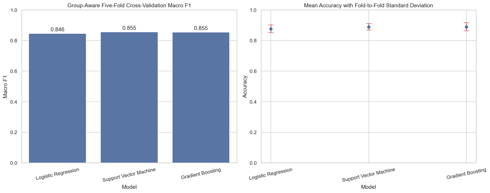

# Sleep Disorder Classification

A reproducible machine-learning project that classifies a record as
**Healthy**, **Insomnia**, or **Sleep Apnea** from sleep, lifestyle, and
physiological features.

The deployable artifact is one scikit-learn pipeline containing feature
engineering, missing-value handling, encoding, scaling, and classification.
Training and prediction therefore apply exactly the same transformations.

## Results

First, one stratified, group-disjoint fold is reserved as a holdout. Models are
then compared with stratified, group-aware five-fold cross-validation on the
remaining training rows.
Rows with identical engineered model features stay in the same fold, preventing
equivalent patient profiles from appearing in both training and validation.
Grouping ignores unused columns and treats normalized BMI labels and blood
pressure formatting consistently.
Selection was based on mean macro F1, which gives equal importance to all
three classes.

| Model | Macro F1 | Mean accuracy | Fold accuracy SD |
| --- | ---: | ---: | ---: |
| Logistic Regression | 0.848 | 0.886 | 0.039 |
| **Support Vector Machine** | **0.874** | **0.903** | **0.014** |
| Gradient Boosting | 0.851 | 0.886 | 0.025 |

Support Vector Machine achieved the highest unrounded mean macro F1 and was
fitted on the 299 training rows for the saved pipeline. On the 75 reserved
holdout rows, it achieved **0.883 macro F1** and **0.920 accuracy**. The holdout
was not used to choose the model. Full per-class scores and a confusion matrix
are in [`reports/holdout_evaluation.json`](reports/holdout_evaluation.json).
These are internal dataset estimates, not results from an external test set.



## What Was Corrected

- The model now saves preprocessing and classification as one pipeline.
- Training and prediction use identical feature transformations.
- `Person ID` is excluded because it is an identifier, not a clinical feature.
- Blood pressure is parsed into systolic and diastolic values, and severe
  hypertension is checked before the broader stage-2 condition.
- Categorical features use an encoder that safely handles unseen values.
- Numeric and categorical missing values are imputed inside each validation
  fold, preventing preprocessing leakage.
- Equivalent engineered feature rows are assigned to the same validation group
  to prevent duplicate-profile leakage, even when raw formatting or unused
  columns differ.
- Model selection uses stratified, group-aware five-fold cross-validation
  within a training partition; a group-disjoint holdout evaluates the winner.

## Repository Structure

```text
sleep-disorder-classification/
├── data/
│   └── README.md
├── examples/
│   ├── patient.json
│   └── patients.csv
├── models/
│   └── sleep_disorder_pipeline.joblib
├── reports/
│   ├── model_comparison.png
│   └── holdout_evaluation.json
├── src/
│   ├── train.py
│   ├── predict.py
│   ├── evaluate.py
│   ├── evaluation.py
│   ├── model_info.py
│   ├── output.py
│   └── preprocessing.py
├── tests/
│   ├── test_prediction.py
│   ├── test_evaluation.py
│   ├── test_model_info.py
│   ├── test_output.py
│   ├── test_preprocessing.py
│   └── test_training.py
├── .github/workflows/ci.yml
├── .dockerignore
├── .gitignore
├── Dockerfile
├── LICENSE
├── README.md
└── requirements.txt
```

## Dataset

The project uses the
[Sleep Health and Lifestyle Dataset](https://www.kaggle.com/datasets/uom190346a/sleep-health-and-lifestyle-dataset).
The local training file contains 374 records and 13 columns. Missing target
values are interpreted as `Healthy`.

The dataset is published separately under **CC0: Public Domain**. It is not
covered by this repository's MIT License. Download instructions are available
in [`data/README.md`](data/README.md); the dataset CSV is intentionally excluded
from Git.

## Installation

Python 3.11 or newer is recommended.

```bash
git clone https://github.com/Dochikhoa2006/Sleeping-Disorder-Multi-Classification.git
cd Sleeping-Disorder-Multi-Classification
python -m venv .venv
source .venv/bin/activate
python -m pip install --upgrade pip
python -m pip install -r requirements.txt
```

On Windows PowerShell, activate the environment with:

```powershell
.venv\Scripts\Activate.ps1
```

## Train

Place the dataset at
`data/Sleep_health_and_lifestyle_dataset.csv`, then run:

```bash
python -m src.train
```

This command compares the three candidate models, then regenerates:

- `models/sleep_disorder_pipeline.joblib`
- `reports/model_comparison.png`
- `reports/holdout_evaluation.json`

Optional paths can be supplied with `--data`, `--model-output`,
`--report-output`, and `--evaluation-output`.
All four paths must differ, including when symlinks resolve to the same file.
Path collisions are rejected before loading data or updating any artifacts.

Training requires at least one row and a `Sleep Disorder` column. Non-missing
labels must be exactly `Healthy`, `Insomnia`, or `Sleep Apnea`; unsupported
labels (including typos) are rejected before model selection or artifact
writes. Missing labels continue to be interpreted as `Healthy`.

Model comparison stops if a cross-validation fold fails or returns a
non-finite score, so incomplete validation results cannot select the saved
model. Existing artifacts are not updated in that case.
Every fold's macro F1 uses the full training class list; classes absent from
a validation fold contribute zero rather than disappearing from the average.

## Inspect the saved model

View the selected model, class labels, training metadata, cross-validation
results, and SHA-256 fingerprint without supplying patient data:

```bash
python -m src.model_info
python -m src.model_info --model models/sleep_disorder_pipeline.joblib
python -m src.model_info --include-features
```

`--include-features` adds a `transformed_features` array containing the numeric
and encoded categorical column names in classifier input order. This option
requires a pipeline with preprocessing steps.

The command prints JSON to standard output, which can be redirected to a file.
Training metadata and validation results are `null` for classifiers that do
not store them. Only inspect trusted Joblib files, as loading them can execute
code.

For programmatic inspection, retrieve the transformed feature names from the
saved pipeline's preprocessing steps:

```python
import joblib

pipeline = joblib.load("models/sleep_disorder_pipeline.joblib")
feature_names = pipeline[:-1].get_feature_names_out()
```

## Evaluate on labeled data

To assess the saved model on another labeled CSV, include all input feature
columns and a `Sleep Disorder` column with explicit `Healthy`, `Insomnia`, or
`Sleep Apnea` labels:

```bash
python -m src.evaluate --data external_patients.csv --output external_evaluation.json
```

Omit `--output` to print the complete JSON report to standard output without
creating a report file, for example when piping the result to another tool:

```bash
python -m src.evaluate --data external_patients.csv
```

File reports replace their destination only after writing succeeds. A failed
write preserves any existing report and removes the temporary file.

Gzip-compressed CSVs are also accepted with `--data external_patients.csv.gz`.
The dataset fingerprint identifies the original compressed file contents.

The JSON report contains accuracy, macro F1, per-class precision and recall,
and a confusion matrix. The `dataset_sha256` and `model_sha256` fields identify
the exact CSV and model file contents used, so reports can be traced to their
inputs even when filenames are reused. It also counts rows whose engineered
features match a profile used to fit the model. Those rows are excluded from
the metrics; the command fails if no unseen profiles remain. Training
fingerprints are stored in the model artifact. As with the training report,
these metrics are only as representative as the supplied dataset.

The `class_row_counts` section breaks down total, training-overlap, and
evaluated rows for every model class, including classes with zero rows. This
shows whether excluding training profiles leaves a class underrepresented.

The report also includes `unique_evaluated_profiles` and
`duplicate_evaluated_rows`, based on engineered model features. Equivalent
profiles with different IDs or formatting count as repeats. Metrics still
include every evaluated row; these counts make repeated profiles visible.

## Predict

Try the included synthetic patient examples with the saved model:

```bash
python -m src.predict --input-json examples/patient.json
python -m src.predict --input-csv examples/patients.csv --output-csv predictions.csv
```

The CSV example includes a `Record ID` column that is preserved in the exported
predictions. These examples also work with `--validate-only` (omit the output
option) to check their format without loading a model.

Run the interactive predictor:

```bash
python -m src.predict
```

For a repeatable non-interactive prediction, create `patient.json`:

```json
{
  "Gender": "Male",
  "Age": 31,
  "Occupation": "Software Engineer",
  "Sleep Duration": 7.2,
  "Quality of Sleep": 8,
  "Physical Activity Level": 60,
  "Stress Level": 4,
  "BMI Category": "Normal",
  "Blood Pressure": "120/80",
  "Heart Rate": 70,
  "Daily Steps": 8000
}
```

Then run:

```bash
python -m src.predict --input-json patient.json
```

For several patients, supply a JSON array of objects with the same fields.
JSON files may use UTF-8 with or without a byte-order mark.
Predictions are returned in input order, and invalid records are identified by
their position. Duplicate JSON field names are rejected, including when their
values match, so repeated fields cannot silently overwrite patient data.
To save machine-readable results:

```bash
python -m src.predict --input-json patients.json --output-json predictions.json
```

The output file contains an array of predicted class names in the same order
as the input. A single patient object also works with `--output-json` and
produces a one-element array.

### CSV batch prediction

For spreadsheet exports, save a CSV with the same feature names as column
headers and one patient per row. Extra columns, such as a local record ID, are
preserved in the output:

```bash
python -m src.predict --input-csv patients.csv --output-csv predictions.csv
```

The output adds a `Predicted Sleep Disorder` column. Numeric fields must contain
numbers; blood pressure uses `systolic/diastolic` format. The command reports
the CSV row number for invalid records and does not write an output file until
all rows have passed validation. The input and output paths must differ.

JSON and CSV prediction exports are written to a temporary file beside the
destination, then replace it after a successful write. If writing fails, any
existing export is preserved and the temporary file is removed.

### Validate inputs without predicting

Check JSON or CSV patient records before running inference:

```bash
python -m src.predict --input-json patients.json --validate-only
python -m src.predict --input-csv patients.csv --validate-only
```

This mode applies the same input validation as prediction and prints the number
of valid records. It requires no model file, stops on invalid records, and
cannot be combined with `--output-json` or `--output-csv`.

Only load `.joblib` files from sources you trust. Joblib artifacts can execute
code when loaded.

## Tests

```bash
python -m unittest discover -s tests -v
```

GitHub Actions runs the same test command with Python 3.11, 3.12, and 3.13 for
every push and pull request. Each version runs independently, so a failure on
one version does not cancel the other checks.

## Docker

Build the inference image:

```bash
docker build -t sleep-disorder-classifier .
```

Run it interactively:

```bash
docker run --rm -it sleep-disorder-classifier
```

Or provide a JSON file:

```bash
docker run --rm \
  -v "$PWD/patient.json:/tmp/patient.json:ro" \
  sleep-disorder-classifier \
  --input-json /tmp/patient.json
```

## Tech Stack

- Python
- pandas and NumPy
- scikit-learn
- SciPy
- Matplotlib and seaborn
- joblib

Exact tested dependency versions are pinned in `requirements.txt`.

## Limitations

- The dataset is small and synthetic, so reported scores may not generalize to
  real clinical populations.
- The model has not been clinically validated.
- Predictions depend on self-reported and simplified health features.
- Fold standard deviations describe variation among five correlated
  validation folds; they are not population confidence intervals or
  guarantees for future data.
- The holdout is one split of a small synthetic dataset; its high score may
  vary substantially with a different split and needs confirmation on external
  data. Cross-validation scores used for selection may still be optimistic.

## License

The source code in this repository is licensed under the
[MIT License](LICENSE).

The dataset is a separate work distributed by its publisher under
[CC0: Public Domain](https://www.kaggle.com/datasets/uom190346a/sleep-health-and-lifestyle-dataset).
The MIT License does not apply to the dataset.

## Citation

Do, Chi Khoa (2026). *Sleep Health and Lifestyle Dataset Analysis and
Prediction*.

## Contact

Chi Khoa Do — dochikhoa2006@gmail.com
